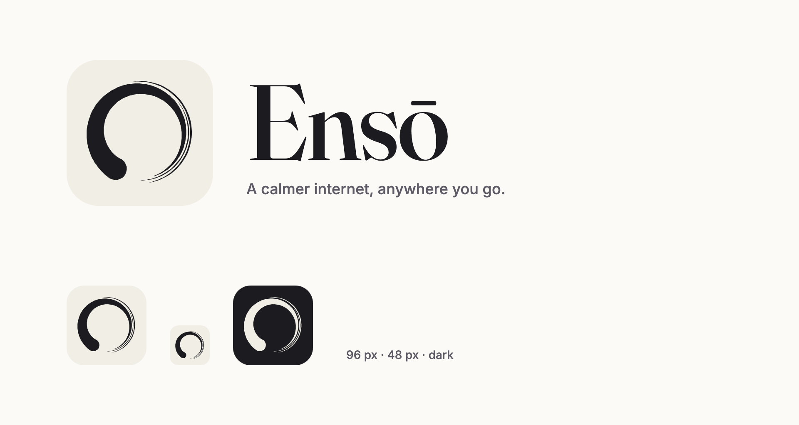

# Ensō

An Android web browser for the Galaxy Z Fold that stays in sync with the [Zen](https://zen-browser.app) desktop browser. The Spaces, folders and pinned tabs on your computer show up on your phone, and changes go both ways.

Ensō is a personal companion app, not an official Zen product.

## Highlights

- **Two layouts in one app.** A one-handed bottom bar on the outer screen, and a Zen-style sidebar with split view when unfolded. Folding never loses your place.
- **Two-way sync with Zen** through your Mozilla account.
- **Quick Tabs** for fast lookups that don't clutter your Spaces.
- **Link previews, ad blocking (uBlock Origin built in), add-ons, voice search and dark mode.**

  
  
  

Design mockups

## Built with

Kotlin · Jetpack Compose · GeckoView · Mozilla Android Components · Gradle

## Build it

Open the project in Android Studio, or run `./gradlew assembleDebug`. It needs Android 8.0 (API 26) or newer.

The full product and design spec is in [docs/SPEC.md](docs/SPEC.md).

## Licenses

Ensō bundles [uBlock Origin](https://github.com/gorhill/uBlock) (GPL-3.0) and the Inter font (SIL OFL). Their licenses are in [app/src/main/assets/licenses](app/src/main/assets/licenses).
